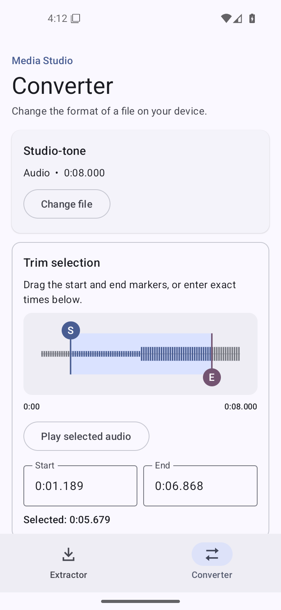

# Media Studio for Android

**Turn a shared link or a local recording into just the clip you want.** Drag two markers, listen to the cut, and save the result to Downloads. Media Studio runs yt-dlp and FFmpeg on your phone.

[](https://github.com/lns2bt/media-studio-android/actions/workflows/android.yml)
[](https://github.com/lns2bt/media-studio-android/releases/latest)

[](LICENSE)

**[Download the ARM64 APK](https://github.com/lns2bt/media-studio-android/releases/download/v0.1/media-studio-v0.1-arm64-debug.apk)** · [User guide](docs/GUIDE.md) · [Release notes](CHANGELOG.md)

| Extractor · start with a link | Converter · start with a file |
| --- | --- |
| Share a URL from another app. Read its duration, enter a time range, and choose video with sound, silent video, or audio only. | Open a file from Android's Files app. Hear the audio and trim on its waveform, even when the source is a video. |
| Keep the original codecs or convert to MP4 or MP3. If a source cannot deliver a usable excerpt, opt into downloading it in full and trimming locally. | Refine either boundary in **0.1-second steps**. Audition the first or last two seconds to avoid clipping a word or including a breath. |

<details open>
<summary><strong>Inside the converter</strong></summary>
<p align="center"></p>
</details>

### Try it: turn a video into a ringtone-length MP3

1. In Files, **share a video to Media Studio**. The converter opens with its audio waveform.
2. Drag the two boundaries and use the preview to check the cut.
3. Check **Audio only**. MP3 is selected automatically; AAC, Opus and FLAC are also available.
4. Tap **Export selection**. Rename or share the result, or choose **Continue editing**. The original file stays untouched.

For video exports, choose **H.264 / MP4** or **VP9 / WebM**. **Keep original** avoids re-encoding; video cuts in this mode may start near a keyframe.

### Install or build

The [first public release](https://github.com/lns2bt/media-studio-android/releases/tag/v0.1) is a **debug-signed** APK for ARM64 devices running Android 10 or later. Development and device testing have focused on the Pixel 8a. Download the APK and open it on your phone, or install via `adb install -r media-studio-v0.1-arm64-debug.apk`.

To build from source, use JDK 17 or 21 and Android SDK 36:

```sh
git clone https://github.com/lns2bt/media-studio-android.git
cd media-studio-android
./gradlew :app:testDebugUnitTest :app:assembleDebug
adb install -r app/build/outputs/apk/debug/app-debug.apk
```

For an x86_64 emulator, add `-PmediaAbi=x86_64` to the Gradle command.

### How it works

The Kotlin / Jetpack Compose app handles Android sharing, document access and waveform editing. [yt-dlp](https://github.com/yt-dlp/yt-dlp) selects and downloads streams; [FFmpeg](https://ffmpeg.org/) processes them locally via [youtubedl-android](https://github.com/yausername/youtubedl-android). Exports use Android's MediaStore and can continue in the background. Link availability and partial-transfer support depend on the provider; no account or hosted conversion service is required.

- [User guide and format choices](docs/GUIDE.md)
- [Device checks and export verification](DEVICE_CHECKS.md)
- [Third-party components and sources](docs/THIRD_PARTY.md)
- [GPL-3.0-only license](LICENSE)
